<p align="center">
  
</p>

<h1 align="center">Jocker-MX</h1>
<p align="center"><b>Software DJ libre de audio, video, karaoke y stems con IA</b><br>
Windows · Linux · macOS · Android — <a href="LICENSE">GPL-3.0-or-later</a></p>

---

**Jocker-MX** es una aplicación DJ de código abierto que busca ofrecer **las mismas funciones y capacidades que VirtualDJ 2026**, incluidas las que allí requieren licencia PRO o Business (cualquier controlador, uso profesional, IA avanzada, sin marcas de agua, multiusuario), pero **gratis, libre y en cuatro plataformas**.

> **Estado: 0.14.0-dev (alfa).** Nuevo: la **interfaz táctil** ya cubre todo: **FX y stems** en cada deck, y páginas táctiles de **Automix**, **Pads** y **Karaoke**; mantener pulsada una canción abre sus acciones. Para teléfonos, tabletas y **TV Box** (control remoto), en horizontal y vertical. Antes: **transmisión en vivo** a **Icecast 2** y **SHOUTcast** en **Opus** o **MP3**, con reconexión automática y título de lo que suena. Antes: **video** — MP4, MOV, MKV, WebM… en los decks, con la imagen pegada al audio (tempo, pausa, cue, scratch) y **mezcla de video** con el crossfader (fundido, barrido o corte) hacia la **pantalla del público**. Ya estaban el karaoke CD+G/LRC, los estilos de transición, el programador de eventos, la estructura de pistas, el Automix y las listas. Funcionan **stems con IA**, 2 decks, mezclador, sync, key lock, cues, loops, scratch, formas de onda, biblioteca con base de datos, controladores MIDI, tonalidad Camelot, 6 efectos sincronizados, **sampler de 8 pads** y **grabación de la mezcla con lista de canciones**. Ver [lo que ya funciona](#lo-que-ya-funciona-en-0140-dev).

<p align="center"></p>
<p align="center">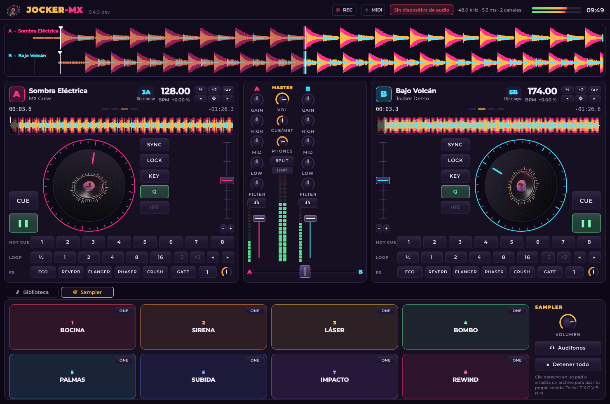 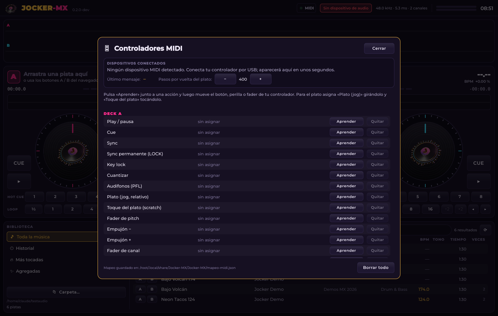</p>
<p align="center">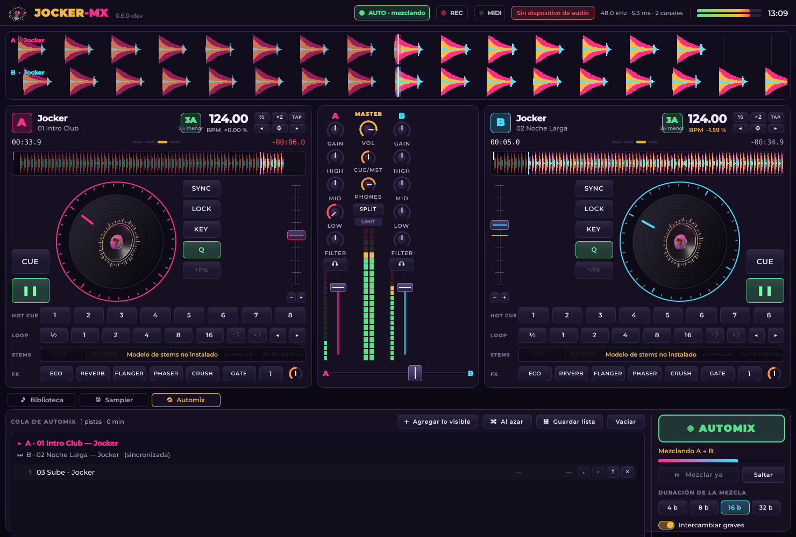</p>
<p align="center">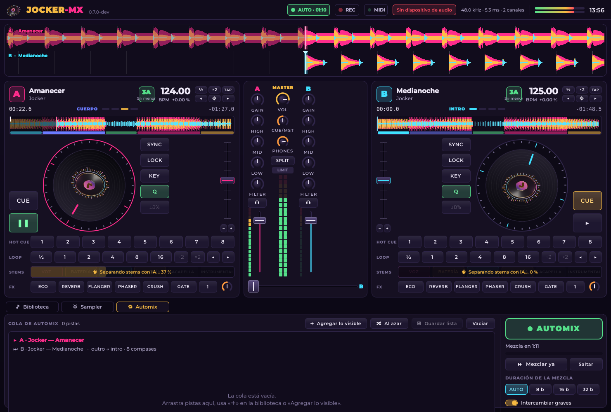</p>
<p align="center">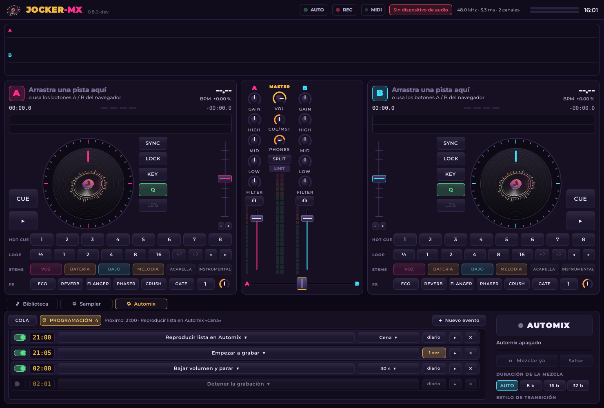</p>
<p align="center">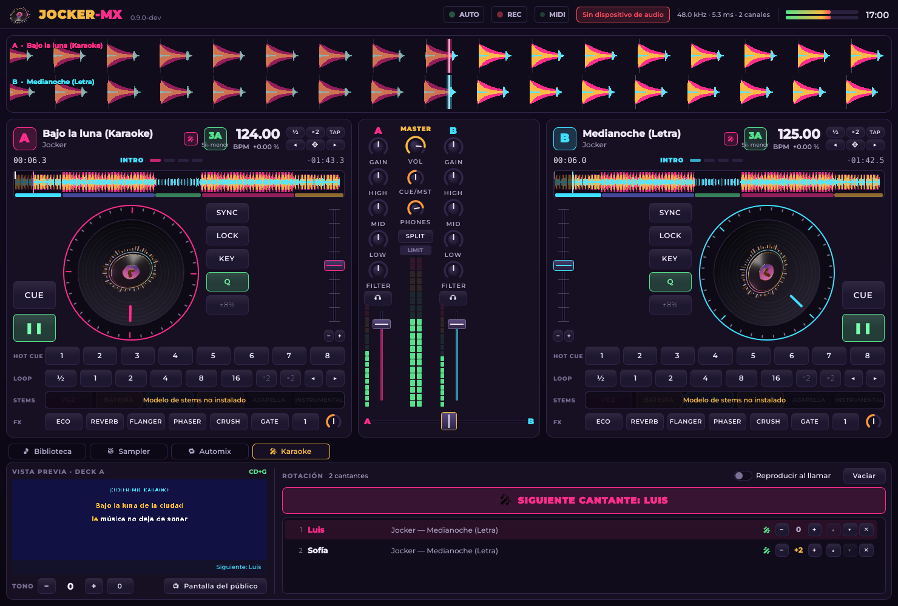</p>
<p align="center">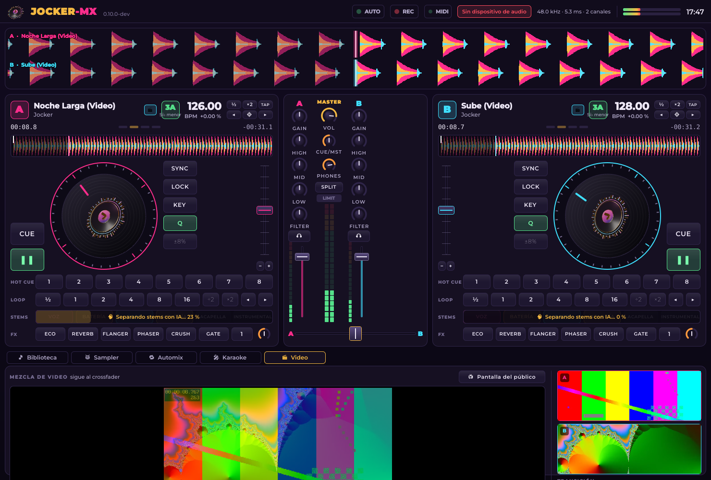</p>
<p align="center">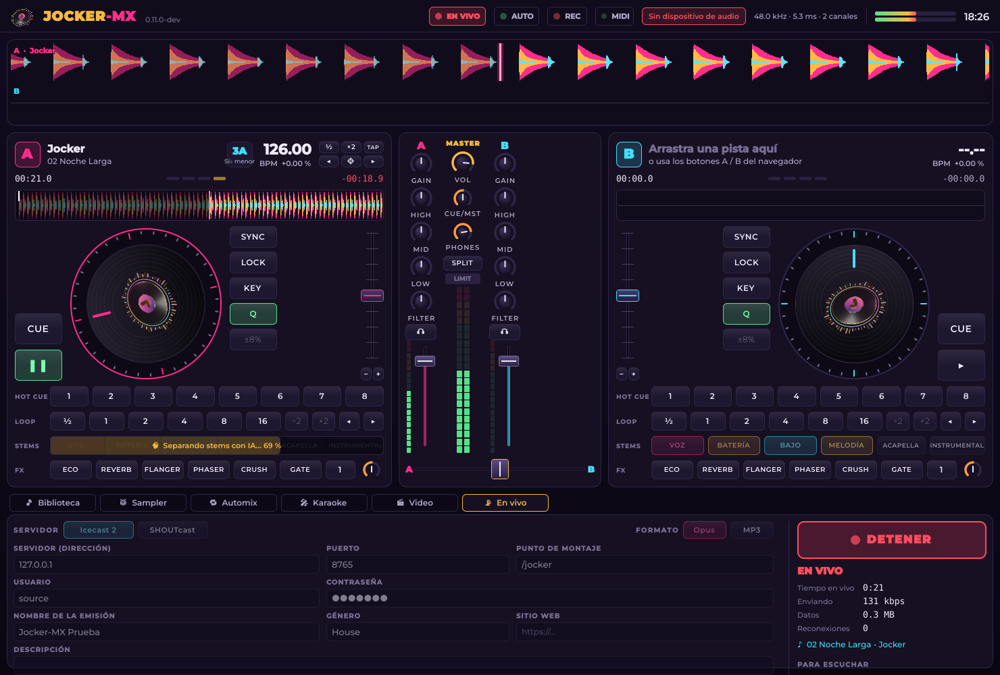</p>
<p align="center">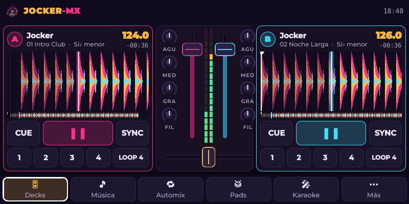 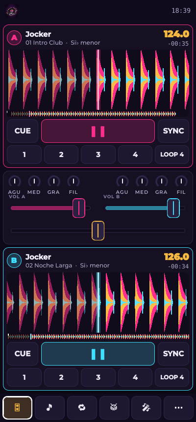</p>
<p align="center">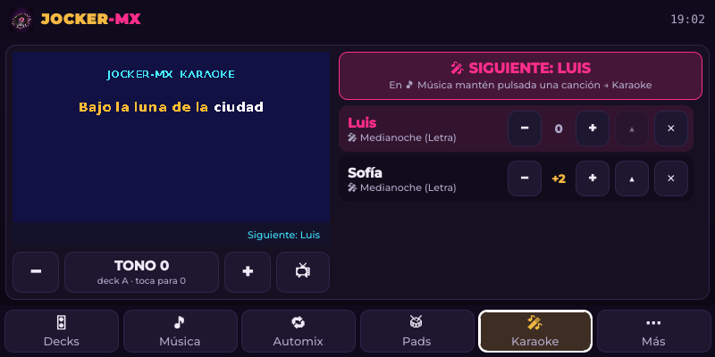</p>

## Lo que ya funciona en 0.14.0-dev
- **2 decks** con carga de **MP3, WAV, FLAC, OGG, AAC/M4A y AIFF** (arrastrar y soltar o botones A/B del navegador).
- **Análisis automático de BPM y beatgrid** (error típico < 3 ms en pruebas).
- **Pitch** ±8/16/25/50/100 %, **key lock** (Rubber Band), **SYNC** (tempo + fase) y **LOCK** (sync continuo), *nudge*.
- **CUE** estilo CDJ (con vista previa mientras se mantiene), **8 hot cues** que se guardan por pista (clic derecho = borrar), **cuantización**.
- **Loops automáticos** (½ a 16 beats), mitad/doble, **beat jump**.
- **Plato virtual**: centro = scratch, aro = empujar/frenar; también se puede hacer scratch arrastrando la forma de onda.
- **Mezclador**: gain, EQ de 3 bandas con *kill*, filtro HPF/LPF de una perilla, faders, crossfader, VU por canal y maestro, **limitador** maestro.
- **Audífonos (PFL)** en tarjetas de 4 canales o modo **SPLIT** (cue izquierda / master derecha) con un cable divisor.
- **Formas de onda de 3 bandas** (graves magenta, medios oro, agudos cian) con rejilla de beats, cues y loops.
- **Biblioteca SQLite**: escaneo incremental de tu carpeta, lectura de etiquetas (ID3 en MP3, Vorbis en FLAC, INFO en WAV), columnas de título, artista, álbum, género, BPM, tonalidad, duración y veces tocada; vistas **Historial**, **Más tocadas** y **Agregadas**.
- **Búsqueda** sin acentos ni mayúsculas («cancion» encuentra «Canción») y filtros `bpm:120-128` y `key:8A`.
- **Beatgrid editable**: ½, ×2, TAP, mover la rejilla ±10 ms y «beat aquí»; se guarda por pista junto con cue y hot cues.
- **Automix**: cola de reproducción que se mezcla sola entre los decks A y B. Salta los silencios, sale al inicio de un compás, **sincroniza tempo y fase** cuando los BPM son compatibles (±8 %, también medio/doble tiempo), cruza el crossfader e **intercambia los graves** a mitad de la mezcla; si no son compatibles hace un fundido. Mezcla de 4/8/16/32 beats, **Mezclar ya** (en el siguiente compás), saltar, repetir la cola, regreso suave al tempo original y cuenta regresiva en la barra superior.
- **Estructura de cada pista**: detecta **intro, cuerpo, break, drop y outro** por compases; se ve como una franja de colores bajo la forma de onda (clic = saltar a esa sección sin perder el compás) y el nombre de la sección actual junto al indicador de beats.
- **Automix AUTO**: con la estructura, mezcla la **outro** de la pista que sale con la **intro** de la que entra, calculando la duración para que el cuerpo de la nueva entre justo cuando la anterior termina.
- **Interfaz táctil**: se activa sola en Android (y con «📱 TÁCTIL» en escritorio). Botones grandes, pestañas abajo (Decks, Música, Automix, Pads, Karaoke, Más), deck con forma de onda para hacer scratch con el dedo, CUE/PLAY/SYNC y pads con cuatro modos (**CUES**, **LOOP** con salto de beats, **FX** y **STEMS** con acapella/instrumental), tempo, y mezclador con EQ, filtro, volúmenes y crossfader. Se acomoda en **horizontal y vertical**. En **Android TV / TV Box** se maneja con el **control remoto** (flechas mueven el foco, OK pulsa, Atrás regresa; dos veces Atrás para salir), aparece en el lanzador de TV y mantiene la pantalla encendida.
- **Transmisión en vivo**: manda la mezcla final (decks, efectos, sampler y todo) a un servidor **Icecast 2** (PUT, o SOURCE en versiones antiguas) o **SHOUTcast** v1/v2, en **Opus** (Ogg, 64–256 kbps) o **MP3** (96–320 kbps). Se reconecta sola si se cae la conexión, envía el título de lo que más se oye y muestra tiempo al aire, kbps reales y datos enviados; indicador **EN VIVO** en la barra superior. Probado contra un Icecast 2.4.4 real con ffmpeg como oyente.
- **Video**: carga videos (MP4, M4V, MOV, MKV, WebM, AVI…) como cualquier pista: el audio pasa por el motor de Jocker-MX (EQ, efectos, stems, key lock) y la imagen lo sigue con la misma velocidad, pausa, cue, búsquedas y scratch (desfase medido ≈ 20 ms con +8 % de tempo). Panel **🎬 Video** con la mezcla que sigue al crossfader (**fundido**, **barrido** o **corte**), vista de cada deck y **pantalla del público** compartida con el karaoke. Con Qt Multimedia (FFmpeg en Windows, macOS y Android; GStreamer en Linux), que además da a Android el audio de MP4/M4A.
- **Karaoke**: si junto a la canción hay un **.cdg** o un **.lrc** con el mismo nombre, se carga solo (🎤 en la biblioteca y en el deck). Gráficos CD+G completos (bloques, XOR, desplazamiento, paleta, borde) y letras LRC con barrido por línea o por palabra. **Tono** de −6 a +6 semitonos sin cambiar el tempo. **Rotación de cantantes** con nombre, canción y tono de cada uno; «Siguiente cantante» la carga en el deck libre desde el principio. **Pantalla del público** en una ventana aparte (TV o segundo monitor, pantalla completa con doble clic) con quién canta y quién sigue.
- **Estilos de transición**: **Mezcla** (crossfade sincronizado con intercambio de graves), **Filtro** (la que sale pierde los graves con un paso alto mientras la nueva se abre), **Eco** (la que sale se repite un compás y la nueva entra de golpe en su cuerpo, con la cola del eco de fondo) y **Corte** (cambio seco en el compás exacto). **Auto** elige mezcla si los tempos encajan y eco si no.
- **Programador de eventos**: acciones a una hora, diarias o de una sola vez: encender/apagar el Automix, reproducir una lista, mezclar ya, empezar/detener la grabación y **bajar el volumen y parar** con fundido. Se guardan entre sesiones y se pueden probar al momento.
- **Listas de reproducción** en la biblioteca: crear, renombrar, reordenar, buscar dentro, arrastrar pistas sobre una lista, mandarlas al Automix o guardar la cola como lista.
- **Stems con IA**: separa cada pista en **voz, batería, bajo y melodía** en segundo plano al cargarla; botones por stem, **ACAPELLA** e **INSTRUMENTAL**, todo sin cortes y compatible con key lock, scratch, loops y efectos. Usa el modelo libre Spleeter 4 stems (Deezer, MIT) con un **motor de inferencia propio en C++** (sin servicios en la nube ni runtimes externos).
- **Tonalidad automática** con notación **Camelot** (y Open Key): se muestra en cada deck y en la biblioteca, en **verde** cuando combina armónicamente con lo que está sonando.
- **Efectos por deck sincronizados al beat**: eco, reverb, flanger, phaser, crush (bitcrusher) y gate, con duración de ¼ a 8 beats y perilla de cantidad.
- **Sampler de 8 pads** con sonidos incluidos (bocina, sirena, láser, bombo, palmas, subida, impacto, rewind — sintetizados, libres de derechos), modos ONE / LOOP / HOLD, tus propios sonidos (clic derecho o arrastrar) y teclas `Z X C V B N M ,`.
- **Grabación** de la mezcla (botón **REC** o `Ctrl+R`) en WAV de 24 bits, con **lista de canciones** (.txt) y hoja **.cue** con los tiempos de cada pista.
- **Analizar todo**: calcula BPM, tonalidad y duración de toda la biblioteca en segundo plano.
- **Controladores MIDI** (USB, cualquier marca): detección automática, **MIDI learn** de 65 acciones por deck y del mezclador (incluido plato con scratch), mapeo guardado en JSON.
- Atajos: `Q`/`P` play A/B · `W`/`O` sync · `1-4` / `7-0` hot cues · `A`/`L` loop de 4 · `←`/`→` crossfader · `Ctrl+M` Automix · `Ctrl+Intro` mezclar ya · `Ctrl+K` siguiente cantante.

### Instalar
Descarga el instalador de tu sistema en [Releases](https://github.com/chago2850-blip/Jocker-MX/releases) (lo genera automáticamente GitHub Actions):

| Sistema | Archivo |
|---|---|
| macOS 12+ (Apple Silicon e Intel) | `.dmg` — arrastra la app a Aplicaciones; la primera vez: *Ajustes del Sistema → Privacidad y seguridad → Abrir de todos modos* (aún sin notarizar) |
| Windows 10/11 | instalador `.exe` o `.zip` portátil |
| Ubuntu 24.04+ / Debian 13+ | `.deb` → `sudo apt install ./jocker-mx_*.deb` |
| Fedora 40+ | `.rpm` → `sudo dnf install ./jocker-mx-*.rpm` |
| Android 9+ (ARM64) | `.apk` (alfa; pensada para tableta en horizontal) — permite instalar «apps desconocidas» |

### Compilar desde el código
El modelo de stems no se guarda en el repositorio (78 MB); genéralo una vez con:
```bash
pip install tensorflow-cpu tf_keras numpy
mkdir -p sp4 models && curl -sSL https://github.com/deezer/spleeter/releases/download/v1.4.0/4stems.tar.gz | tar xz -C sp4
TF_USE_LEGACY_KERAS=1 python3 tools/export_stems_model.py sp4 models/jx-stems-4.bin /tmp/ref.json
```
Sin el modelo, la app funciona igual pero sin stems.

```bash
# Requisitos: CMake ≥ 3.21, compilador C++20, Qt 6.4+ (Quick, QuickControls2, Concurrent)
cmake -S . -B build -DCMAKE_BUILD_TYPE=Release
cmake --build build
./build/jx-tests          # pruebas del motor
./build/jocker-mx         # ejecutar
```
Opciones útiles: `jocker-mx --library ~/Música -a pista1.mp3 -b pista2.flac --play`.

## Funciones previstas
- 🎚️ **2 a 99 decks**, mezclador completo, sync, *key lock*, hot cues, loops, *slip*, beat jump, Sandbox.
- 🧠 **Stems en tiempo real** con IA local: voz, melodía, bajo, kick y hi-hat.
- 🎛️ **Controladores MIDI/HID** plug-and-play, MIDI learn, JockerScript, **DVS/timecode**.
- ✨ **120+ efectos**, sampler ilimitado, pads, ScratchSeq, plugins **CLAP/VST3/LV2/AU**.
- 🎬 **Video y VJ** hasta 4K, transiciones, visualizaciones, videoskins, cámara y texto.
- 🎤 **Karaoke** (CDG/MP3+G, KAR, LRC, video), cola de cantantes y karaoke automático con IA.
- 📚 Biblioteca rápida, smart folders, compatibilidad armónica, historial, importación desde otras apps.
- 🤖 **IA local**: asistente de selección musical, letras automáticas, Fluid BeatGrid, BPM Stabilizer, voces para *drops*, scripting por lenguaje natural, visuales generativos.
- 📡 Grabación, Icecast/Shoutcast, transmisión de video RTMP/SRT, Ableton Link, DMX/OS2L, app remota y peticiones del público.

## Documentación
| Documento | Contenido |
|---|---|
| [01 · Investigación de VirtualDJ](docs/01-INVESTIGACION-VIRTUALDJ.md) | Funcionamiento, capacidades, IA 2026 y licencias del producto de referencia |
| [02 · Matriz de funciones](docs/02-MATRIZ-DE-FUNCIONES.md) | Cada función de VirtualDJ → su implementación en Jocker-MX, fase y prioridad |
| [03 · Arquitectura](docs/03-ARQUITECTURA.md) | Pila tecnológica, motor de audio, stems, UI, Android |
| [04 · Plan de trabajo](docs/04-PLAN-DE-TRABAJO.md) | Fases F0-F13, hitos 0.1 → 1.0 en 24 meses, equipo y riesgos |
| [05 · Licencias y dependencias](docs/05-LICENCIAS-Y-DEPENDENCIAS.md) | Compatibilidad GPL-3.0+, modelos de IA, *clean room* |
| [06 · Manual de usuario](docs/06-MANUAL-DE-USUARIO.md) | Cómo usar Jocker-MX paso a paso |

## Hoja de ruta
| Versión | Mes | Hito |
|---|---|---|
| 0.1 "Primer beat" | 6 | Decks, mezclador, sync, biblioteca (escritorio) |
| 0.5 "Cabina" | 12 | Controladores, FX, sampler, stems, Android alfa |
| 0.8 "Escenario" | 17 | Video, karaoke, ~~automix~~ (adelantado a 0.7), DVS, broadcast |
| 0.9 RC | 21 | IA completa, Android beta |
| **1.0 "Jocker"** | 24 | Paridad con VirtualDJ, instaladores para las 4 plataformas |

## Identidad visual
<p align="center"></p>

El logo 3D (disco de vinilo con monograma "J" dorado, anillo de neón cian-magenta-ámbar y barras de ecualizador) se genera de forma reproducible con Blender: [`assets/logo/render_logo.py`](assets/logo/render_logo.py) y [`compose.py`](assets/logo/compose.py). Los iconos para Windows (`.ico`), macOS (`.icns`), Linux (PNG 16-512) y Android (mipmaps y *adaptive icon*) están en [`assets/icons/`](assets/icons/).

## Contribuir
Lee [CONTRIBUTING.md](CONTRIBUTING.md). Toda aportación se publica bajo GPL-3.0-or-later.

## Licencia y aviso
Copyright © 2026 Santiago Miguel y colaboradores de Jocker-MX — contacto: chago2850@gmail.com.
Distribuido bajo la [GNU GPL v3.0 o posterior](LICENSE).

Jocker-MX es un proyecto independiente, sin relación con Atomix Productions. "VirtualDJ" y demás marcas citadas pertenecen a sus respectivos propietarios y se mencionan sólo con fines descriptivos y de compatibilidad.
