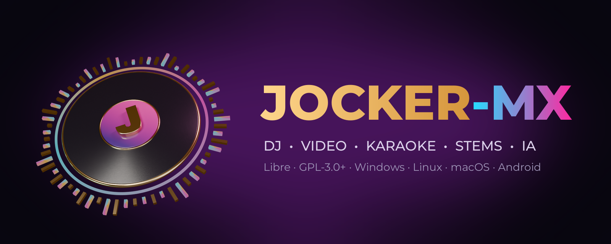
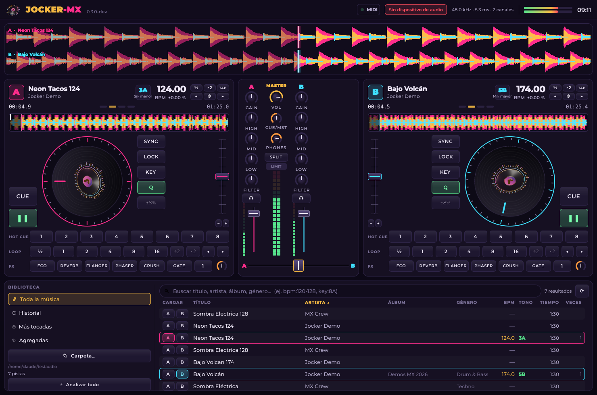

<p align="center">
  
</p>

<h1 align="center">Jocker-MX</h1>
<p align="center"><b>Software DJ libre de audio, video, karaoke y stems con IA</b><br>
Windows · Linux · macOS · Android — <a href="LICENSE">GPL-3.0-or-later</a></p>

---

**Jocker-MX** es una aplicación DJ de código abierto que busca ofrecer **las mismas funciones y capacidades que VirtualDJ 2026**, incluidas las que allí requieren licencia PRO o Business (cualquier controlador, uso profesional, IA avanzada, sin marcas de agua, multiusuario), pero **gratis, libre y en cuatro plataformas**.

> **Estado: 0.1.0-dev (alfa).** Ya funciona el primer corte: 2 decks, mezclador, sync, key lock, cues, loops, scratch, formas de onda y navegador. Ver [lo que ya funciona](#lo-que-ya-funciona-en-010-dev).

<p align="center"></p>

## Lo que ya funciona en 0.1.0-dev
- **2 decks** con carga de **MP3, WAV y FLAC** (arrastrar y soltar o botones A/B del navegador).
- **Análisis automático de BPM y beatgrid** (error típico < 3 ms en pruebas).
- **Pitch** ±8/16/25/50/100 %, **key lock** (Rubber Band), **SYNC** (tempo + fase) y **LOCK** (sync continuo), *nudge*.
- **CUE** estilo CDJ (con vista previa mientras se mantiene), **8 hot cues** que se guardan por pista (clic derecho = borrar), **cuantización**.
- **Loops automáticos** (½ a 16 beats), mitad/doble, **beat jump**.
- **Plato virtual**: centro = scratch, aro = empujar/frenar; también se puede hacer scratch arrastrando la forma de onda.
- **Mezclador**: gain, EQ de 3 bandas con *kill*, filtro HPF/LPF de una perilla, faders, crossfader, VU por canal y maestro, **limitador** maestro.
- **Audífonos (PFL)** en tarjetas de 4 canales o modo **SPLIT** (cue izquierda / master derecha) con un cable divisor.
- **Formas de onda de 3 bandas** (graves magenta, medios oro, agudos cian) con rejilla de beats, cues y loops.
- **Navegador** de carpeta con búsqueda instantánea y ordenamiento.
- Atajos: `Q`/`P` play A/B · `W`/`O` sync · `1-4` / `7-0` hot cues · `A`/`L` loop de 4 · `←`/`→` crossfader.

### Instalar
Descarga el instalador de tu sistema en [Releases](https://github.com/chago2850-blip/Jocker-MX/releases) (lo genera automáticamente GitHub Actions):

| Sistema | Archivo |
|---|---|
| macOS 12+ (Apple Silicon e Intel) | `.dmg` — arrastra la app a Aplicaciones; la primera vez: *Ajustes del Sistema → Privacidad y seguridad → Abrir de todos modos* (aún sin notarizar) |
| Windows 10/11 | instalador `.exe` o `.zip` portátil |
| Ubuntu 24.04+ / Debian 13+ | `.deb` → `sudo apt install ./jocker-mx_*.deb` |
| Fedora 40+ | `.rpm` → `sudo dnf install ./jocker-mx-*.rpm` |
| Android | en desarrollo (fase F11) |

### Compilar desde el código
```bash
# Requisitos: CMake ≥ 3.21, compilador C++20, Qt 6.4+ (Quick, QuickControls2, Concurrent)
cmake -S . -B build -DCMAKE_BUILD_TYPE=Release
cmake --build build
./build/jx-tests          # pruebas del motor
./build/jocker-mx         # ejecutar
```
Opciones útiles: `jocker-mx --library ~/Música -a pista1.mp3 -b pista2.flac --play`.

## Funciones previstas
- 🎚️ **2 a 99 decks**, mezclador completo, sync, *key lock*, hot cues, loops, *slip*, beat jump, Sandbox.
- 🧠 **Stems en tiempo real** con IA local: voz, melodía, bajo, kick y hi-hat.
- 🎛️ **Controladores MIDI/HID** plug-and-play, MIDI learn, JockerScript, **DVS/timecode**.
- ✨ **120+ efectos**, sampler ilimitado, pads, ScratchSeq, plugins **CLAP/VST3/LV2/AU**.
- 🎬 **Video y VJ** hasta 4K, transiciones, visualizaciones, videoskins, cámara y texto.
- 🎤 **Karaoke** (CDG/MP3+G, KAR, LRC, video), cola de cantantes y karaoke automático con IA.
- 📚 Biblioteca rápida, smart folders, compatibilidad armónica, historial, importación desde otras apps.
- 🤖 **IA local**: asistente de selección musical, letras automáticas, Fluid BeatGrid, BPM Stabilizer, voces para *drops*, scripting por lenguaje natural, visuales generativos.
- 📡 Grabación, Icecast/Shoutcast, transmisión de video RTMP/SRT, Ableton Link, DMX/OS2L, app remota y peticiones del público.

## Documentación
| Documento | Contenido |
|---|---|
| [01 · Investigación de VirtualDJ](docs/01-INVESTIGACION-VIRTUALDJ.md) | Funcionamiento, capacidades, IA 2026 y licencias del producto de referencia |
| [02 · Matriz de funciones](docs/02-MATRIZ-DE-FUNCIONES.md) | Cada función de VirtualDJ → su implementación en Jocker-MX, fase y prioridad |
| [03 · Arquitectura](docs/03-ARQUITECTURA.md) | Pila tecnológica, motor de audio, stems, UI, Android |
| [04 · Plan de trabajo](docs/04-PLAN-DE-TRABAJO.md) | Fases F0-F13, hitos 0.1 → 1.0 en 24 meses, equipo y riesgos |
| [05 · Licencias y dependencias](docs/05-LICENCIAS-Y-DEPENDENCIAS.md) | Compatibilidad GPL-3.0+, modelos de IA, *clean room* |
| [06 · Manual de usuario](docs/06-MANUAL-DE-USUARIO.md) | Cómo usar Jocker-MX 0.1 paso a paso |

## Hoja de ruta
| Versión | Mes | Hito |
|---|---|---|
| 0.1 "Primer beat" | 6 | Decks, mezclador, sync, biblioteca (escritorio) |
| 0.5 "Cabina" | 12 | Controladores, FX, sampler, stems, Android alfa |
| 0.8 "Escenario" | 17 | Video, karaoke, automix, DVS, broadcast |
| 0.9 RC | 21 | IA completa, Android beta |
| **1.0 "Jocker"** | 24 | Paridad con VirtualDJ, instaladores para las 4 plataformas |

## Identidad visual
<p align="center"></p>

El logo 3D (disco de vinilo con monograma "J" dorado, anillo de neón cian-magenta-ámbar y barras de ecualizador) se genera de forma reproducible con Blender: [`assets/logo/render_logo.py`](assets/logo/render_logo.py) y [`compose.py`](assets/logo/compose.py). Los iconos para Windows (`.ico`), macOS (`.icns`), Linux (PNG 16-512) y Android (mipmaps y *adaptive icon*) están en [`assets/icons/`](assets/icons/).

## Contribuir
Lee [CONTRIBUTING.md](CONTRIBUTING.md). Toda aportación se publica bajo GPL-3.0-or-later.

## Licencia y aviso
Copyright © 2026 Santiago Miguel y colaboradores de Jocker-MX — contacto: chago2850@gmail.com.
Distribuido bajo la [GNU GPL v3.0 o posterior](LICENSE).

Jocker-MX es un proyecto independiente, sin relación con Atomix Productions. "VirtualDJ" y demás marcas citadas pertenecen a sus respectivos propietarios y se mencionan sólo con fines descriptivos y de compatibilidad.
