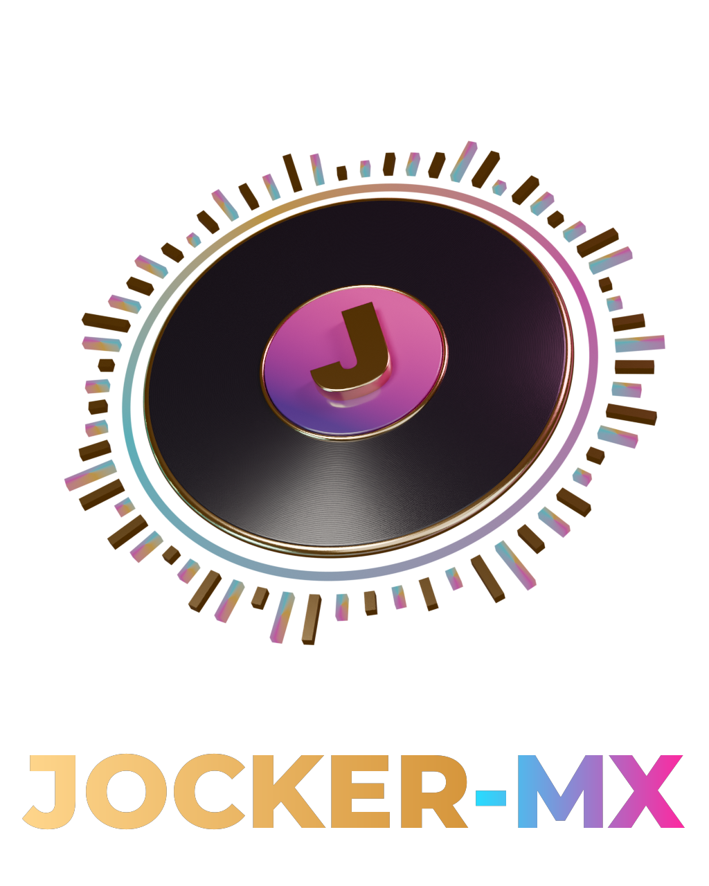

  

<h1 align="center">Jocker-MX</h1>

<b>Software DJ libre de audio, video, karaoke y stems con IA</b> 
Windows · Linux · macOS · Android — <a href="LICENSE">GPL-3.0-or-later</a>

---

**Jocker-MX** es una aplicación DJ de código abierto que busca ofrecer **las mismas funciones y capacidades que VirtualDJ 2026**, incluidas las que allí requieren licencia PRO o Business (cualquier controlador, uso profesional, IA avanzada, sin marcas de agua, multiusuario), pero **gratis, libre y en cuatro plataformas**.

> Estado: **fase de planeación (F0)**. Este repositorio contiene la investigación, la arquitectura, el plan de trabajo y la identidad visual. El desarrollo del código comienza con la fase F0.

## Funciones previstas
- 🎚️ **2 a 99 decks**, mezclador completo, sync, *key lock*, hot cues, loops, *slip*, beat jump, Sandbox.
- 🧠 **Stems en tiempo real** con IA local: voz, melodía, bajo, kick y hi-hat.
- 🎛️ **Controladores MIDI/HID** plug-and-play, MIDI learn, JockerScript, **DVS/timecode**.
- ✨ **120+ efectos**, sampler ilimitado, pads, ScratchSeq, plugins **CLAP/VST3/LV2/AU**.
- 🎬 **Video y VJ** hasta 4K, transiciones, visualizaciones, videoskins, cámara y texto.
- 🎤 **Karaoke** (CDG/MP3+G, KAR, LRC, video), cola de cantantes y karaoke automático con IA.
- 📚 Biblioteca rápida, smart folders, compatibilidad armónica, historial, importación desde otras apps.
- 🤖 **IA local**: asistente de selección musical, letras automáticas, Fluid BeatGrid, BPM Stabilizer, voces para *drops*, scripting por lenguaje natural, visuales generativos.
- 📡 Grabación, Icecast/Shoutcast, transmisión de video RTMP/SRT, Ableton Link, DMX/OS2L, app remota y peticiones del público.

## Documentación
| Documento | Contenido |
|---|---|
| [01 · Investigación de VirtualDJ](docs/01-INVESTIGACION-VIRTUALDJ.md) | Funcionamiento, capacidades, IA 2026 y licencias del producto de referencia |
| [02 · Matriz de funciones](docs/02-MATRIZ-DE-FUNCIONES.md) | Cada función de VirtualDJ → su implementación en Jocker-MX, fase y prioridad |
| [03 · Arquitectura](docs/03-ARQUITECTURA.md) | Pila tecnológica, motor de audio, stems, UI, Android |
| [04 · Plan de trabajo](docs/04-PLAN-DE-TRABAJO.md) | Fases F0-F13, hitos 0.1 → 1.0 en 24 meses, equipo y riesgos |
| [05 · Licencias y dependencias](docs/05-LICENCIAS-Y-DEPENDENCIAS.md) | Compatibilidad GPL-3.0+, modelos de IA, *clean room* |

## Hoja de ruta
| Versión | Mes | Hito |
|---|---|---|
| 0.1 "Primer beat" | 6 | Decks, mezclador, sync, biblioteca (escritorio) |
| 0.5 "Cabina" | 12 | Controladores, FX, sampler, stems, Android alfa |
| 0.8 "Escenario" | 17 | Video, karaoke, automix, DVS, broadcast |
| 0.9 RC | 21 | IA completa, Android beta |
| **1.0 "Jocker"** | 24 | Paridad con VirtualDJ, instaladores para las 4 plataformas |

## Identidad visual

El logo 3D (disco de vinilo con monograma "J" dorado, anillo de neón cian-magenta-ámbar y barras de ecualizador) se genera de forma reproducible con Blender: [`assets/logo/render_logo.py`](assets/logo/render_logo.py) y [`compose.py`](assets/logo/compose.py). Los iconos para Windows (`.ico`), macOS (`.icns`), Linux (PNG 16-512) y Android (mipmaps y *adaptive icon*) están en [`assets/icons/`](assets/icons/).

## Contribuir
Lee [CONTRIBUTING.md](CONTRIBUTING.md). Toda aportación se publica bajo GPL-3.0-or-later.

## Licencia y aviso
Copyright © 2026 Santiago Miguel y colaboradores de Jocker-MX — contacto: chago2850@gmail.com.
Distribuido bajo la [GNU GPL v3.0 o posterior](LICENSE).

Jocker-MX es un proyecto independiente, sin relación con Atomix Productions. "VirtualDJ" y demás marcas citadas pertenecen a sus respectivos propietarios y se mencionan sólo con fines descriptivos y de compatibilidad.
